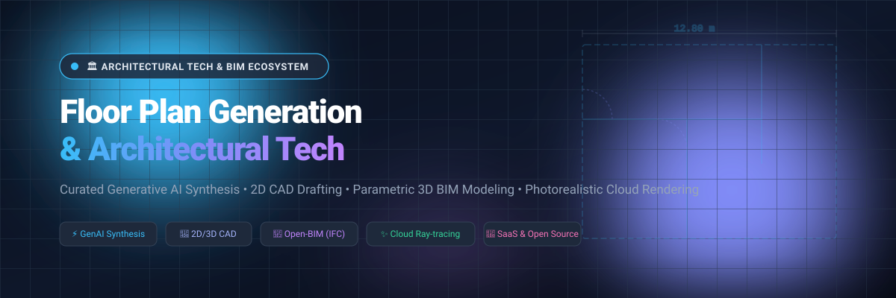

# Awesome-Floor-Plan-Generation-Architectural-Tech


  





  
  
  
  
  



# 🏛️ Top Floor Plan Generation & Architectural Tech

**Curated List of SaaS/Commercial Platforms & Open-Source GitHub Projects**  
*Focused on AI Floor Plan Synthesis, 2D/3D Architectural CAD, Building Information Modeling (BIM), Parametric Layout Generation & Interior Photorealistic Rendering*  
**Last updated: November 2026**

This repository tracks notable **SaaS/Commercial platforms** and **open-source projects** for **Floor Plan Generation & Architectural Tech**. These tools power generative AI floor-plan synthesis (`haydenschmitty/floorplan`, `HouseDiffusion`, `CubiCasa`), 2D architectural drafting (`LibreCAD`, `QCAD`), parametric 3D BIM modeling (`FreeCAD`, `Bonsai / BlenderBIM`, `IfcOpenShell`), browser-based 3D room planners (`Sweet Home 3D`, `Blueprint3D`), and photorealistic interior visualization for architects, civil engineers, real-estate technologists, and interior designers.

**Examples** include SketchUp Web (Trimble), Coohom (Manycore Tech), Homestyler (Easyhome / Alibaba), SmartDraw, Planner 5D, Floorplanner, Cedreo, RoomSketcher, Foyr Neo, and Sweet Home 3D (Hosted/Commercial Store Edition) (the category leaders).

**🚀 Open-source emphasis**: This section is heavily expanded with every major active project for generative floor-plan synthesis (`haydenschmitty/floorplan`, `HouseDiffusion`, `PlanGraph`, `Arch-Agent`), open-source BIM & architectural CAD (`Bonsai / BlenderBIM`, `FreeCAD`, `IfcOpenShell`, `LibreCAD`, `QCAD`), and browser/desktop 3D home & floor-plan designers (`Sweet Home 3D`, `Blueprint3D`, `Floorplan-3D`, `Open3D`) — ideal for AEC engineers, proptech builders, and researchers eliminating per-seat CAD/BIM lock-in.

🤝 Contributions welcome! Open a PR to add/update entries. Keep descriptions factual and link to official sites.

## 📑 Table of Contents
- [📊 Sector Overview & Market Dynamics](#-sector-overview--market-dynamics)
- [☁️ SaaS/Hosted & Commercial Platforms](#️-saashosted--commercial-platforms)
- [💻 Open-Source GitHub Projects](#-open-source-github-projects)
- [🛠️ How to Contribute](#️-how-to-contribute)
- [⚠️ Disclaimer](#️-disclaimer)
- [💖 Support & Thank You](#-support--thank-you)

## 📊 Sector Overview & Market Dynamics

The global Architectural CAD, BIM & Floor Plan Visualization Software market is valued at approximately **$14.8B–$18.2B+ in 2026**, expanding at a ~11%–15% CAGR propelled by generative AI spatial layout synthesis, real-estate digital twins, and cloud BIM collaboration. The professional AEC drafting and cloud interior-rendering layer exhibits **strong winner-take-most consolidation** around Trimble (SketchUp), Autodesk, and Manycore/Coohom, whereas the open-BIM (`IFC`), 2D CAD, and generative floor-plan research ecosystems are **rapidly advancing through open-source standards** (`FreeCAD`, `Bonsai/BlenderBIM`, `IfcOpenShell`, `Sweet Home 3D`, `LibreCAD`).

## ☁️ SaaS/Hosted & Commercial Platforms

*Sorted descending by company valuation / annual revenue scale.*

| Platform | Description | Company Scale (Valuation / Revenue) | Starting Paid Tier | Free Tier / Trial Limit |
| :--- | :--- | :--- | :--- | :--- |
| **[SketchUp Web (Trimble)](https://sketchup.com)** | Industry-standard browser and desktop 3D architectural modeling, floor-plan layout, and PreDesign building performance suite. | **Part of Trimble Inc.** (~$3.7B+ annual revenue; ~$16B+ public market cap) | **$119 / year** ($9.92/mo billed annually for SketchUp Go web/iPad) | **Forever Free SketchUp Free Web Tier** (Unlimited basic 3D modeling in browser with **10 GB Trimble Connect cloud storage**; 7-day Pro trial) |
| **[Coohom (Manycore Tech)](https://coohom.com)** | Cloud-native 3D floor-plan generator, interior design studio, and ultra-fast cloud ray-tracing rendering platform for architects and furniture brands. | **~$1.5B–$2.0B+ Valuation** (Manycore Tech; ~$100M+ annual revenue) | **$19 / month** billed annually ($25/mo monthly for Pro individual plan) | **Forever Free Basic Plan** (Unlimited basic 2D/3D floor plans, free model library, and standard-resolution renders with watermark; 7-day Pro trial) |
| **[Homestyler (Easyhome / Alibaba)](https://homestyler.com)** | Cloud 3D floor-plan and interior visualization platform featuring AI Room Styler, real-brand 3D furniture catalogs, and panoramic 4K cloud renders. | **Backed by Easyhome & Alibaba** (~$1.8B+ Easyhome parent revenue) | **$4.90 / month** billed annually ($9.90/mo monthly for Pro individual plan) | **Forever Free Basic Plan** (Unlimited floor plans, access to free 3D furniture catalog, and unlimited **1K/2K standard cloud renders**) |
| **[SmartDraw](https://smartdraw.com)** | Cloud architectural diagramming and scaled 2D floor-plan creator with thousands of CAD symbols, wall dimensioning, and Visio/AutoCAD compatibility. | **~$50M–$100M Est. Scale** (Profitable enterprise diagramming software vendor) | **$9.95 / month** billed annually ($119.40/yr single-user cloud license) | **7-Day Full-Access Free Trial** (Includes full floor-plan templates, CAD DWG import/export, and cloud sharing; no perpetual free tier) |
| **[Planner 5D](https://planner5d.com)** | AI-powered 2D/3D home and floor-plan design platform featuring smartphone LiDAR room scanning, AI Plan Recognition, and photorealistic snapshots. | **~$40M–$70M Est. Valuation** (~$15M–$25M est. ARR; >100M registered users) | **$4.99 / month** billed annually ($59.99/yr Premium) or **$9.99/mo** monthly | **Forever Free Basic Plan** (Basic 2D/3D floor-plan editor and limited free furniture catalog; AI Plan Recognition & 4K renders require Premium) |
| **[Floorplanner](https://floorplanner.com)** | Browser-based 2D and 3D floor-plan creation platform widely used by real estate agencies for interactive property layouts and quick 3D renders. | **~$25M–$50M Est. Scale** (Profitable Dutch proptech SaaS; >30M users) | **$5 / month** Plus plan (or pay-as-you-go credit packs starting at **$5 for 5 credits**) | **Forever Free Basic Account** (Unlimited projects with **1 floor per project**, standard 2D/3D exports, and basic furniture library) |
| **[Cedreo](https://cedreo.com)** | Cloud 3D home design software enabling builders and remodelers to draw complete 2D/3D floor plans and generate photorealistic renders in under 2 hours. | **~$25M–$40M Est. Valuation** (~$10M+ est. ARR; $15M+ VC funding) | **$49 / month** billed annually ($588/yr Personal) or **$119 / mo** Pro | **Forever Free Starter Plan** (**1 project**, 5 realistic renders, and full 2D/3D floor-plan drawing tools free forever) |
| **[RoomSketcher](https://roomsketcher.com)** | Cloud-based 2D/3D floor-plan software offering Blueprint-to-Floor-Plan ordering, Live 3D walkthroughs, and high-res branded real-estate layouts. | **~$15M–$30M Est. Scale** (Profitable Norwegian proptech software company) | **$2.00 / month** billed annually ($24/yr Pro) or **$12.00 / mo** Team + render credits | **Forever Free Basic Account** (Up to **2 projects**, 2D floor plan drawing, and Live 3D preview; high-res print/3D renders use paid credits) |
| **[Foyr Neo](https://foyr.com)** | Cloud-native interior design and floor-plan software featuring AI-assisted lighting/staging and fast cloud rendering without local GPU hardware. | **~$15M–$25M Est. Valuation** (~$5M+ est. ARR; $10M+ VC funding) | **$22 / month** billed annually ($44/mo monthly for Essential plan) | **14-Day Free Trial** (Includes full 2D/3D floor-plan modeling, 60,000+ 3D models, and complimentary cloud render credits; no perpetual free tier) |
| **[Sweet Home 3D (Commercial Cloud / App Store)](https://sweethome3d.com)** | Hosted HTML5/WebGL online viewer and commercial App Store edition of the beloved interior floor-plan designer with expanded texture/furniture packs. | **Independent Open-Core Studio** (eTeks; >50M downloads worldwide) | **$14.99 one-time** (Mac/Windows App Store edition with 1,600+ 3D models & 400 textures) | **100% Free Open-Source Desktop & Web Version** (Core GPL desktop app and Sweet Home 3D JS Online are completely free forever) |

## 💻 Open-Source GitHub Projects

| Project | License / Hosting Cost | Free Tier / Self-Hosted Limit | Description |
| :--- | :--- | :--- | :--- |
| **[Floorplan (`haydenschmitty/floorplan`)](https://github.com)** | **Open-Source** ($0 local/self-hosted floor-plan generation & layout tool) | **100% Free forever** (Unlimited floor-plan generation, spatial layout synthesis, and programmatic architectural modeling locally) | Open-source floor-plan generation and architectural layout project built to streamline programmatic room planning and spatial design. |
